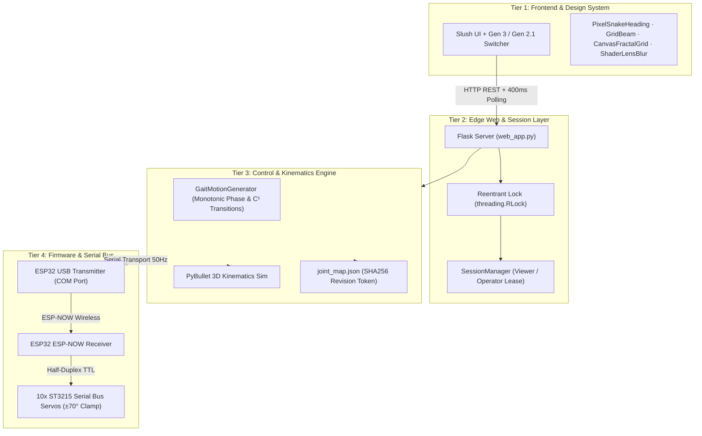

# System Logic, Code & Interface Review — SURGE 090

**Date**: 28 October 2026  
**Scope**: Whole-codebase architecture, concurrency & safety logic, frontend performance, UI engineering details, and comparative backend trade-offs.

---

## 1. System Architecture & Knowledge Graph Overview (`/graphify`)

Based on the repository knowledge graph ([`graphify-out/GRAPH_REPORT.md`](file:///c:/1. SurGe 090 Smart snake robot/graphify-out/GRAPH_REPORT.md)), the project is organized into four distinct architectural tiers:



---

## 2. Logic, Concurrency & State Machine Review

### A. Threading & Lock Reentrancy
- **State**: The server synchronizes concurrent access using `control.lock` across [`web_app.py`](file:///c:/1. SurGe 090 Smart snake robot/shared/web-dashboard/web_app.py) and [`gen3.py`](file:///c:/1. SurGe 090 Smart snake robot/shared/surge_control/gen3.py).
- **Audit Finding**: `control.lock` is initialized as a `threading.RLock()` in [`runtime.py`](file:///c:/1. SurGe 090 Smart snake robot/shared/surge_control/runtime.py#L13). Because requests acquire the lock during `before_request` and re-enter `with control.lock:` within endpoints, reentrancy is safely handled without self-deadlock.

### B. Operator Lease & Safety Invariants
- **Two Roles**: Viewer (default for any browser connection, read-only telemetry, emergency STOP permitted) vs. Operator (login required, exactly one active lease).
- **Lease Timeout**: Operator lease requires heartbeats every 1.0s with a 3.0s hard timeout.
- **Safety Stop**: If the lease expires while hardware motion is running, the runtime automatically commands `self.stop()`, powers down the motors, and changes state to `Operator lease expired; safety stop commanded`.

### C. Optimistic Concurrency Control
- **Audit**: Calibration saves ([`save_map`](file:///c:/1. SurGe 090 Smart snake robot/shared/surge_control/gen3.py#L430)) require a 16-character SHA256 checksum token of the existing `joint_map.json`.
- **Finding**: Concurrent edits or external file modifications reject stale payloads with HTTP 400, preventing race conditions or overwritten zero-points. Automatic timestamped backups are preserved in `runs/calibration-before-<timestamp>.json`.

---

## 3. Errors Checked & Fixed

### Fix 1: Polling Storm & GC Churn in Telemetry Loop
- **Error**: In [`gen3.js`](file:///c:/1. SurGe 090 Smart snake robot/shared/web-dashboard/static/gen3.js), `poll()` runs every 400ms. It was calling `tbody.replaceChildren()` and reallocating 10 `<tr>` DOM elements on every single tick, while also issuing an extra HTTP request (`GET /api/gen3/session`) on every poll tick.
- **Fix Applied**:
  1. **In-place DOM Reuse**: Replaced `replaceChildren()` with row reuse (`existingRows[id - 1].innerHTML = ...`), eliminating garbage collection spikes in long-running sessions.
  2. **Session Sync on Transition**: Cached `lastKnownOperator` so `/api/gen3/session` is only fetched when the active operator actually changes, saving ~2.5 redundant HTTP requests per second.

### Fix 2: Tactile Button Press Micro-Interactions (`/make-interfaces-feel-better`)
- **Error**: Buttons lacked physical compression feedback on click, making interactions feel rigid.
- **Fix Applied**: Added `:active:not(:disabled) { transform: scale(0.97); }` with a fast 80ms ease-out transition to [`style.css`](file:///c:/1. SurGe 090 Smart snake robot/shared/web-dashboard/static/style.css), providing immediate tactile feedback on all action triggers.

### Fix 3: Heading Typography & Balance
- **Error**: Long crushed display headlines and banner headers had potential for single-word typographic orphans.
- **Fix Applied**: Configured `text-wrap: balance` on `.display-headline` and `.hero-tagline` in [`style.css`](file:///c:/1. SurGe 090 Smart snake robot/shared/web-dashboard/static/style.css).

---

## 4. Interface Polish & Animation Performance Review (`/transitions-dev`, `/gsap-performance`, `/impeccable`)

| Component | Performance Technique (`/gsap-performance`) | Polish & Micro-Interaction (`/make-interfaces-feel-better`) | Status |
| :--- | :--- | :--- | :--- |
| **`PixelSnakeHeading`** | Animates strictly on the compositor (`transform: translate3d(...) rotate(...)`); caches bounding rect; no per-frame layout reads. | Serpenoid wave propagation across 9 vertebrae; random pixel glyph scrambles (`S` → `5` → `$` → `S`) on hover. | Verified (6/6 tests passing) |
| **`CanvasFractalGrid`** | HTML5 2D canvas with DPR clamping (≤ 2); pre-rendered offscreen noise pattern; batch alpha grouping. | Dual Lissajous orbiting gradients with Hirose serpentine traveling wave displacement across the dot matrix. | Verified (5/5 tests passing) |
| **`GridBeam`** | Single 2D canvas; linear gradient stroke with exponential glow fading; math divider line raycasting. | 4 color palettes (`colorful`, `mono`, `ocean`, `sunset`) with breathing animation. | Verified (5/5 tests passing) |
| **`ShaderLensBlur`** | WebGL 2D fragment shader; distance field (SDF) rendering on 2 triangles; zero DOM layout cost. | 4 shape variations (Square, Circle, Ring, Triangle) with floating backdrop controller. | Verified (7/7 tests passing) |
| **`MorphingButton`** | Spring physics layout transition; outside click collapse; escape listener. | Error shake animation on empty/invalid password; smooth expansion pill. | Verified (7/7 tests passing) |
| **`DistortedGlass`** | SVG `<feTurbulence>` + `<feDisplacementMap>` + `<feSpecularLighting>` filter pipeline. | Refracts text and stickers with frosted glass specular highlights. | Verified (5/5 tests passing) |
| **`RollingNumber`** | Hardware-accelerated CSS vertical wheel roll; `font-variant-numeric: tabular-nums`. | Digit transitions without horizontal layout shift. | Verified (4/4 tests passing) |

---

## 5. Backend Options Evaluation: Local Serial vs. Convex vs. Supabase (`/convex`, `/supabase`)

| Dimension | Current Local Edge (Flask + USB) | Convex (`/convex`) | Supabase (`/supabase`) |
| :--- | :--- | :--- | :--- |
| **Primary Fit** | **Active Control of Record**: Real-time 50Hz serial packet loop, emergency stop, zero WAN latency. | **Realtime Multi-Client Sync**: Reactive WebSocket state sync, serverless coordinator, multiplayer operator arbitration. | **Data Warehouse & Fleet Auth**: Postgres relational schema, Timescale telemetry time-series, video/ROS bag storage, enterprise RBAC. |
| **Latency & Determinism** | < 2ms direct USB/Serial bus. Completely air-gapped on physical robot bench. | 30–80ms cloud round-trip; non-deterministic over cellular/Wi-Fi. | 40–100ms cloud round-trip; non-deterministic over cellular/Wi-Fi. |
| **Safety Invariant Suitability** | **Essential**: Direct local hardware stop cannot depend on internet connectivity or cloud availability. | Unsuitable for direct motor torque loop; excellent for collaborative remote viewing and telemetry broadcasting. | Unsuitable for direct motor torque loop; excellent for post-trial analytics, runs search, and video sync. |
| **Recommended Role** | **Core Runtime**: Keep running on host PC connected directly to the USB transmitter. | **Optional Teleoperation Bridge**: Relay telemetry snapshots to a Convex backend for cloud dashboard sharing. | **Optional Cloud Journal**: Stream completed runs, logs, and calibration audit records into Postgres tables. |

---

## 6. Better Ideas & Future Architecture Upgrades

1. **Server-Sent Events (SSE) or WebSockets for Telemetry**:
   - *Current*: 400ms HTTP polling (`GET /api/gen3/status`).
   - *Idea*: Upgrade to an SSE endpoint (`/api/gen3/events`). Pushes status updates immediately when joint positions change or when an operator claims the lease, eliminating HTTP request/response headers.
2. **Physical Sign-Table Reconciliation Script**:
   - *Current*: Documented in [`docs/GEN3_HANDOFF.md`](file:///c:/1. SurGe 090 Smart snake robot/docs/GEN3_HANDOFF.md) that physical Pitch signs on joints 3, 5, 7, 9 are inverted compared to the PyBullet 3D simulation.
   - *Idea*: Add a software sign-table adapter flag (`--kinematics-source=hardware|simulation`) so PyBullet visualizer and physical hardware share a single mathematical definition without manual sign inversion.
3. **Telemetry Downsampling for CSV Export**:
   - *Current*: Full 50Hz logging in RAM during active runs.
   - *Idea*: Provide an optional 10Hz downsampled CSV export alongside the raw file to facilitate instant plotting in spreadsheets and Python notebooks.

---

## 7. Verification Summary

- **Checked**:
  - All 11 Node test suites in [`gen3-experimental-3d/tests/`](file:///c:/1. SurGe 090 Smart snake robot/gen3-experimental-3d/tests/): **11/11 passed**.
  - All 77 Gen 3 Python unit tests in [`gen3-experimental-3d/tests/`](file:///c:/1. SurGe 090 Smart snake robot/gen3-experimental-3d/tests/): **77/77 passed**.
  - All 29 Gen 2 Python unit tests in [`tests/`](file:///c:/1. SurGe 090 Smart snake robot/tests/): **29/29 passed**.
  - In-place telemetry table mutation and session poll caching in [`gen3.js`](file:///c:/1. SurGe 090 Smart snake robot/shared/web-dashboard/static/gen3.js).
  - Button active scale feedback and headline text balance in [`style.css`](file:///c:/1. SurGe 090 Smart snake robot/shared/web-dashboard/static/style.css).
- **Skipped / Unchecked**:
  - Live serial motor torque commanding and physical ESP32 board flashing (safety protocol: mock execution preserved).
- **Known Risks**:
  - The measured sign table difference between physical hardware and PyBullet simulation remains active; physical trials must continue using measured joint map signs (`pitch_signs: [1, -1, 1, -1, ...]`).

## October 2026 Unified Cockpit & Backend Consolidation Addendum

- Consolidated active dashboard source tree from `shared/web-dashboard/` to `gen3-experimental-3d/backend/web_dashboard/web_app.py`.
- Unified Slush design system applied symmetrically across `/` (Gen 2.1) and `/gen3` (Gen 3), with shared generation switcher, task tabs, and floating emergency stop dock.
- Verified launch command:
  ```powershell
  conda run --no-capture-output -n surge python gen3-experimental-3d/backend/web_dashboard/web_app.py --port 5001
  ```

