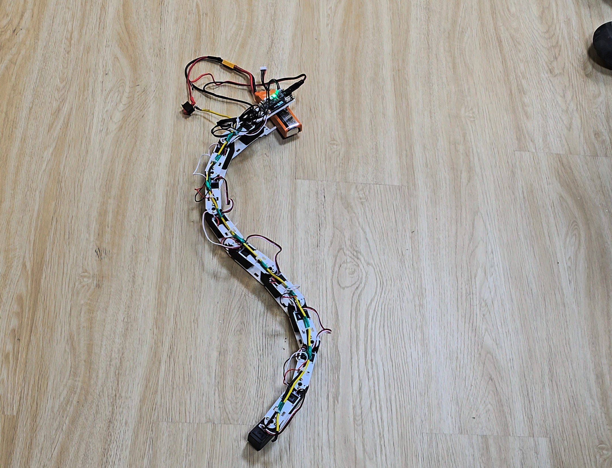

# Archived overview before reorganization

Historical content; use the current root README and Gen 3 handoff for operation.
Links were adjusted for the folder move on 2 November 2026.

# SURGE-090 · Smart Snake Robot

**SURGE 2026 · Indian Institute of Technology Delhi**<br>
Under the supervision of **Prof. Amartansh Dubey**

We are building a modular snake robot to study how joint motion, body geometry
and ground contact affect locomotion. The project brings together mechanical
design, servo control, embedded electronics and simulation.

## Continue the current Gen 3 robot work

**Updated 31 October 2026:** The Gen 2.1 dashboard (`/`) has been restructured to match the operator schematic with a 5-box responsive layout (Mathematical Path generator, Gamepad State & Node instructions, centered 520px Live Trajectory Tracking, full-height Simulation Physics panel, and a 2x5 10-Joint Actuator Telemetry grid spanning columns 1 & 2). The path simulation engine (`path_engine.py`) now ensures continuous whole-path undulation without premature stalls at 20% progress via segment projection, and manual stops conditionally display the run accuracy report only when progress exceeds 20%. Gen 3 console controls (`/gen3`) have been unified with Gen 2.1 paper styling, fixing operator dropdown dimensions, high-contrast morphing password button rendering, and serial port action alignment.

**Updated 26 October 2026:** the physical ten-motor Gen 3 robot now performs
pitch-only waves over ESP-NOW. The owner successfully tested 2° and 5° pitch
waves, a 30-second 5° run, and a 10° run with an 8-second startup/shutdown ramp.
Movement is visible, but forward travel remains small and unmeasured.

**For a new chat, read [the Gen 3 handoff](../GEN3_HANDOFF.md) and the current
[joint map](../../generations/gen3-experimental-3d/joint_map.json) before changing code or asking
the owner to repeat commissioning.** The handoff contains the hardware layout,
direction observations, actual saved signs, firmware fixes, tested commands,
environment setup, evidence and next work. Read the file on disk rather than
copying an older sign table from conversation history.

- Ten ST3215 motors; ID 1 is the head/end opposite the driver, ID 10 is the
  Waveshare ESP32 driver end. Odd IDs bend vertically (pitch), even IDs sideways
  (yaw), in the current resting orientation.
- All commanded straight targets are **2048**. The map is marked calibrated for
  commissioning at **100 counts/s**, with target limits **1252–2844** (about ±70°).
  The owner reports ±90° mechanical clearance; software does not enable ±90°.
- The central battery section has been removed. The 3S 1800 mAh LiPo is external
  on long wires for now; its mass is not on the body and cable drag can affect
  experiments. Motors 7 and 8, previously disconnected, now respond and move.
- Normal control is **PC → USB transmitter ESP32 (currently COM6) → ESP-NOW →
  Waveshare ESP32 bus driver → motors**. Temporary robot USB access was used for
  receiver uploads. COM4 and COM5 on this PC are Bluetooth ports.

Known working larger pitch trial, from the repository root:

```powershell
Set-Location 'C:\1. SurGe 090 Smart snake robot'
python generations/gen3-experimental-3d/test_3d_snake.py --hardware --port COM6 --yaw 0 --pitch 10 --frequency 0.1 --ramp 8 --duration 30
```

Use a clear floor and slack battery wires. Ctrl+C requests STOP; normal completion
returns to neutral and releases torque. This command moves hardware; it is not
a preview. Do not raise amplitude and frequency together or disable fault checks.

The Gen 3 web page is `/gen3`; `/` and `/3d` are still the planar dashboard and
viewer. Navigating between Gen 2.1 (`/`) and Gen 3 (`/gen3`) features a bespoke 3D
robotic-snake loading transition that previews each generation's articulation (planar vs.
spatial 3D) before revealing the initialized destination dashboard. A live Gen 3 3D web viewer, realistic battery-free assembly model and
training system have **not** been implemented. Do not use the planar gait as the
Gen 3 hardware controller. See the handoff for the Python 3.11 conda launch path.

> **Network Security Notice:** The web application has no network security (no authentication/encryption layer) and should only be used on a trusted local network.

## Where the project stands

**Gen 2.0 and Gen 2.1 are working. Our current development work is Gen 3.0.**
The Gen 2 robot uses ST3215 bus servos in a planar chain of eleven segments and
ten joints. Gen 2.0 covers bench and onboard control; Gen 2.1 adds the shared
control software, dashboard, desktop interface and gamepad support.

Gen 3.0 explores alternating yaw and pitch joints for motion beyond a flat
plane. We are working on its connectors, body arrangement and gait experiments.
The CAD and experimental scripts are in [gen3-experimental-3d](../../generations/gen3-experimental-3d/README.md).
It is still in development, with successful small pitch-wave hardware trials and
Gen 2 as the earlier working reference. Current commissioning status is above.



[More prototype photos](../../generations/gen2-st3215/media/README.md) ·
[Gen 2 hardware and control](../../generations/gen2-st3215/README.md) ·
[Gen 3 development](../../generations/gen3-experimental-3d/README.md)


## How we got here

### Gen 1 — Dynamixel prototype

The first design used Dynamixel XL330-M288-T actuators, a U2D2 interface and a
Raspberry Pi running Python. We developed the gait and bus-control code around
that hardware and began printing and checking the body segments.

The original architecture was designed for ten motors with alternating yaw and
pitch joints. Component availability later drove the change to ST3215 servos.
The original code, CAD, reports and presentation material remain
in [gen1-dynamixel](../../generations/gen1-dynamixel/README.md).

Simulation helped keep the control work moving while the hardware was limited.
The Wokwi demonstrator (historical Wokwi files are absent) uses an ESP32 and five
PWM servos to explore travelling-wave motion, sensor inputs and serial tuning.
It is a simplified control experiment rather than a model of the ST3215 bus.

### Gen 2.0 — Planar ST3215 design

We moved to Waveshare ST3215 serial bus servos when the Dynamixel supply became
a blocker. This meant revisiting the servo protocol, motor mounts, power supply
and controller, rather than simply swapping a motor in the existing design.
The resulting planar robot uses ten yaw joints driven by a travelling wave.

The mechanical work developed through several segment revisions. The
[v6 segment](../../generations/gen2-st3215/cad/segments/v6/README.md) brings together double-shear
yokes, motor retention and longitudinal belly features. The ground-contact
geometry matters: lateral undulation needs resistance to sideways slip while
allowing the body to move along its length.

The power distribution evolved too. Early arrangements fed larger groups of
servos through the same connectors. The current
[split power bus v3](../hardware/power_split_bus_v3.md) divides the ten servos
into five fused pairs, with a separate supply path for the controller. The
[hardware notes](../hardware/README.md) retain the earlier designs and the
reasoning behind each revision.

Gen 2.0 supports direct bench control through a USB bridge and an onboard ESP32
gait controller. The onboard firmware also contains current-based stall detection
and an evasion sequence, with telemetry sent to a base station over ESP-NOW.
Those thresholds remain hardware-dependent; working locomotion alone does not
establish obstacle-detection reliability.

### Gen 2.1 — Integrated control software

Gen 2.1 keeps the planar mechanism and brings the host tools onto a common
control package. The web dashboard, desktop app, gamepad and PyBullet simulation
share the gait and hardware interfaces in `shared/surge_control/`.

The host computes joint targets and sends them to an ESP32 receiver over USB,
or through an ESP-NOW transmitter. The receiver handles the servo bus,
per-joint speeds and motion timeout. A separate sensor node provides IMU,
pressure and distance readings.

The simulation has eleven links and ten yaw joints. It is useful for developing
controller behavior and waypoint tracking, but its contact model has not been
calibrated to the physical robot. Path following and trajectory reports are
currently simulation features; hardware localization is still open work.

### Gen 3.0 — Experimental 3D motion

The next stage changes the joint arrangement to alternating yaw and pitch.
That introduces new questions about clearance, mounting direction and how the
body supports itself as it moves out of the plane. The current folder contains
connector and plate-chain CAD, electronics-holder designs and an experimental
waveform script. We keep this work separate from the planar controller so its
mechanical assumptions remain explicit.

## Working with the robot

Choose the firmware that matches the software you intend to run.

| Arrangement | Control path |
|---|---|
| Gen 2.0 bench | Python bench program → USB bridge → servo bus |
| Gen 2.0 onboard | Robot ESP32 computes the gait; ESP-NOW carries telemetry to the base station |
| Gen 2.1 host control | Dashboard, desktop or gamepad → USB or ESP-NOW relay → receiver → servo bus |

The Gen 2.1 receiver has explicit start/stop and a target watchdog. It does not
include the Gen 2.0 onboard firmware's battery/temperature cutoffs or evasion
state machine. Firmware selection and wiring are covered in the
[firmware guide](../../generations/gen2-st3215/firmware/README.md).

For the shared apps, use Python 3.11. From the repository root on Windows:

```powershell
py -3.11 -m venv .venv
.venv/Scripts/python.exe -m pip install -r generations/gen3-experimental-3d/backend/web_dashboard/requirements.txt
.venv/Scripts/python.exe generations/gen3-experimental-3d/backend/web_dashboard/web_app.py
```

Open `http://127.0.0.1:5000`. Start with Simulation, connect, then start motion.
Hardware mode requires a selected serial port and the Gen 2.1 receiver firmware.
The [operating guide](../operations/1_APP_USAGE_MANUAL.md) covers the desktop app, gamepad
and hardware connection in more detail.

## Finding things in this repository

| Folder | Contents |
|---|---|
| [gen1-dynamixel](../../generations/gen1-dynamixel/README.md) | Original prototype, CAD and research material |
| [gen2-st3215](../../generations/gen2-st3215/README.md) | Working planar robot, firmware, mechanical designs and photos |
| [gen3-experimental-3d](../../generations/gen3-experimental-3d/README.md) | Current 3D motion experiments |
| shared (now in the Gen 3 backend) | Common controller, user interfaces and simulations |
| [docs](..) | Operating notes, wiring, hardware history and protocol reference |
| removed (historical removed archive is absent) | Preserved older files and restorable Git snapshots |

The [version map](../versions/VERSIONS.md) connects generation names to individual
hardware and software revisions. Detailed software checks and known limits are
recorded in the [verification notes](../versions/VERIFICATION.md).

## Team

Shashank Jangir · Bhavesh Bansiwal · Mahima Chotiya<br>
SURGE-090, IIT Delhi · Supervisor: Prof. Amartansh Dubey

© 2026 SURGE-090 Team. All rights reserved; shared for academic and research purposes.

## October 2026 Update: Consolidated Dashboard Architecture & Launch Command

The unified web dashboard consolidating Gen 2.1 planar control and Gen 3 3D spatial commissioning has been consolidated under `generations/gen3-experimental-3d/backend/web_dashboard/web_app.py`.

### Unified Dashboard Execution Command

From the repository root (`C:\1. SurGe 090 Smart snake robot`), launch the unified server using the configured `surge` Conda environment:

```powershell
conda run --no-capture-output -n surge python generations/gen3-experimental-3d/backend/web_dashboard/web_app.py --port 5001
```

*(If omitting `--port 5001`, the default port is `5000`.)*

### Available Web Routes
- **Gen 2.1 Planar Cockpit**: [`http://127.0.0.1:5001/`](http://127.0.0.1:5001/) — Live trajectory canvas, mathematical waveform presets, physics tuning, port scanning, and planar controls.
- **Gen 3 3D Console**: [`http://127.0.0.1:5001/gen3`](http://127.0.0.1:5001/gen3) — 10-joint spatial commissioning, finite pitch/yaw trials, physical-order calibration map, operator authentication, disarmed diagnostics, and firmware build/upload.
- **3D Visualization**: [`http://127.0.0.1:5001/3d`](http://127.0.0.1:5001/3d) — WebGL 3D spatial body rendering.


### Security Revalidation & Protocol V3 (October 2026)
- **RFC 2104 HMAC-SHA256 Radio Security**: Keyed FNV-1a has been replaced with standard HMAC-SHA256 authentication and monotonic sequence freshness across binary (`AuthRobotCommand`, `AuthRobotTelemetry`) and text (`AUTH,<seq>,<tag_hex_16>,<cmd>`) frames.
- **Fail-Safe Emergency Stop**: Emergency `STOP` is accepted unconditionally from any RF source to guarantee instantaneous torque cutoff without cryptographic failure modes.
- **EEPROM Protection**: Servo ID reassignment is protected behind a 15-second single-use `MAINT,UNLOCK,CONFIRM` authorization token.
- **Network & Proxy Hardening**: Operator credentials strictly fail closed without configuration; untrusted `X-Forwarded-Proto` header spoofing is blocked via `TRUSTED_PROXIES` allowlist.
- **Audit Reference**: See [`docs/archive/audits/SURGE_090_SECURITY_REVALIDATION.md`](audits/SURGE_090_SECURITY_REVALIDATION.md).

---

## Update — 2 November 2026

**Where the project stands.** The last commit is `fc24e4e` (31 October 2026: Gen 2.1 five-box
dashboard layout, continuous path traversal, unified console UI). Everything dated 31 October –
2 November below is in the working tree and **not yet committed**. No hardware motion was
commanded by the assistant during that work unless stated.

**Gen 3 control console (1–2 Nov).**
- Saved `joint_map.json`: speed 1500, `tracking_error` **216** (was 100), timeout 0.5 s; sign map
  unchanged (pitch ID 1 = 1, IDs 3/5/7/9 = −1, yaw = 1). Software now accepts speed 1–3000
  counts/s; 3000 is a command ceiling, not a measured capability.
- Live telemetry: each joint shows error, peak error and a 2 s error-trend sparkline recorded at
  the 20 Hz loop rate. Colours now use the running job's real limit (fixed a hard-coded 25-count bug).
- Per-joint control: new pose mode (Move to Pose, hold 2–300 s, return to neutral) and per-joint
  gait overrides (enabled, gain 0–2, phase ±180°, bias ±70°), all limit-checked before start.
- Shape presets (Straight, Head raised, Cobra stand, Cobra stand tall, Ring near-closed, S-curve rest)
  and Caterpillar crawl presets (10° commissioning, 20°). Tuned in simulation only.
- Controls has a 3D Gait Preset selector that loads the draft only; it never starts motion.
- Transmitter COM port is recommended from the USB socket and remembered in
  `transmitter_port.json` (gitignored).

**Simulation now uses the owner's CAD assembly (2 Nov).**
- Browser viewer and default PyBullet model load the V2 prototype
  `cad/3D_motion_parts/V2/assembly_neutral_2048_PROTOTYPE_fit_and_load_validation_required_v2.SLDASM`
  (round Ø57 mm bodies, covered tail, head sensor bay), exported read-only from SolidWorks.
- Joint pivots: 20.61 mm head to ID 1, then 58.37 mm; bounds ≈ 679 × 57 × 57 mm.
  Contact boxes follow the CAD section (0.057 m).
- Mass (0.25 kg/body), box inertia and friction (0.8, anisotropy `[0.1, 1, 1]`) are still illustrative.
- New tools `tools/export_native_assembly.ps1` and `tools/export_assembly_simulation.py`
  produce `static/models/gen3-cad.json` and `gen3-body-0..10.obj`. The older KiCad exporter is superseded.
- `--link-length` still selects the older uniform-box bench.
- PyBullet caterpillar result: lag −72° moved +0.21 m in 24 s; +72° moved −0.13 m.
  Shape presets were tuned with the old 0.1 m links and need re-tuning on the CAD spacing.
- Details: `docs/gen3/GEN3_SIMULATION.md`.

**Gen 2.1 radio firmware (31 Oct).**
- Fixed `surge_sign_text_command`: it returned `bool` but its caller used the value as the packet
  length, so only one byte was sent. It now returns the full length.
- At the owner's request, all wireless commands now use **plain text**. Transport was adapted from partner
  repo `Snake_SURGE` commit `7d80490`. The receiver accepts known commands without HMAC, sequence or MAC
  allowlist; use only in a controlled environment.
- Kept: watchdog Stop, torque-off read-back, joint limits, queue-overflow Stop, packet bounds/printable
  checks and EEPROM maintenance lock.
- Both boards were uploaded with servo power disconnected. **COM6 = receiver** (`28:05:a5:4f:e5:ac`),
  **COM7 = PC transmitter** (`68:09:47:5c:10:ec`). HELLO → `SURGE,2.1` exchanges passed, including after
  a transmitter-only reset. Use COM7 for the dashboard.
- `platformio.ini` transmitter monitor: `send_on_enter`, LF line endings.
- New `tests/test_text_auth.cpp` compiles for ESP32. It was not run on the host because no host compiler is installed.

**Hardware status (as of 2 Nov).**
- **No fuses are installed** (owner, 1 Nov). Fuses in the split-bus v3 drawing are design intent only.
- Power: external 3S 1800 mAh LiPo on long wires; the central battery section is removed.
- 31 Oct trial: 30° yaw / 25° pitch, 0.5 Hz, speed 1500. ID 1 had a WRITE failure and IDs 7/8 stopped
  replying. Owner then reported a wiring fault and fixed it.
  Still pending: a logged all-ten diagnostics query, and a repeat of the trial with minimum voltage recorded.
- Both dashboard headers show a BATTERY estimate from cached diagnostic voltages
  (`clamp((V − 11.1) / 1.5 × 100)`). It is a sampled recharge hint, not live state of charge.

**Dashboard and website (31 Oct – 2 Nov).**
- Fonts are self-hosted (Antonio, Bowlby One, Inter; `static/fonts/`). Images are WebP.
- Removed the GSAP bundle, `socket.io.min.js` and `snake_motion.mp4`. `OrbitControls-r128.js` is vendored for `/3d`.
- `web_app.py` adds asset versioning, compression and cache headers.
- Generation-switch transition rewritten as one 2D-canvas controller (shaded 3D and flat planner
  variants, approaching viper head); no GSAP.
- Hero snake trail is 1.5× stronger. Battery indicator added to both headers.
- 2 Nov "AI-look" audit (`docs/archive/AI_LOOK_AUDIT_REPORT.md`, screenshots in `report-assets/`).
  Follow-ups: remediation plan `docs/ideas/ai-look-remediation-plan.md` and research
  `docs/research/ai-look-primary-research.md`. These are **proposals only, not implemented**.

**CAD (to 2 Nov).**
- Gen 3 prototype head/mid/tail parts and neutral assembly are in `generations/gen3-experimental-3d/cad/3D_motion_parts/`
  (V1) and `.../V2/` (round revision, now used by the simulation). All are named
  *PROTOTYPE fit and load validation required*.
- Holders and plates are in `cad/plate chains/`.
- Design brief: `docs/research/GEN3_WAVESHARE_HARDWARE_RESEARCH.md`.
- `generations/gen2-st3215/cad/assembly/Assem3.SLDASM` was deleted from the working tree.

**Research and plans (1–2 Nov).**
- `docs/ideas/gen3-research-roadmap.md` orders the next topics:
  hardware fault → live telemetry → per-joint control → speed → closed loop → caterpillar →
  draw-a-shape → sensors → SLAM.
- `docs/research/solution-of-gen3-research-map.md` is the work log. Telemetry part 1, per-joint control,
  caterpillar and shape presets are done.
- `docs/research/ST3215_SPEED_LIMITS.md`: 1500 counts/s ≈ 22 RPM. The standard ST3215 is ≈ 3072 no-load
  at 12 V, and the driver board's maximum is 5 A.

**Verification (1–2 Nov).**
- Gen 3 Python: 105 tests passed (web, console, hardening, gait, battery), plus 98 targeted
  assembly-simulation tests. All 38 Node suites passed. Offline Chrome checks at 320–1440 px passed.
- New tests: `test_assembly_simulation.py`, `test_battery*.py/.cjs`, `test_bus_metrics.cjs`,
  `test_control_spatial_presets.cjs`, `test_port_detection.py`, `test_pose_presets.cjs`.
- Not verified: clicking Move to Pose in a browser (needs an operator login), and any hardware run of the new features.

**Open items.**
1. Logged all-ten diagnostics query, then repeat the speed-1500 trial with minimum voltage logged.
2. Small pose (≈10°) in simulation, then on the robot. Confirm pitch "up" matches, then run the 10° caterpillar.
3. Measure real masses, friction and fit; re-tune shape presets on the CAD spacing.
4. Telemetry part 2: voltage/temperature/status during motion (needs a receiver firmware change).
5. Install fuses before speed trials 1500 → 1800 → 2200 → 2600.
6. Closed loop, sensors, SLAM. Commit the working tree.
