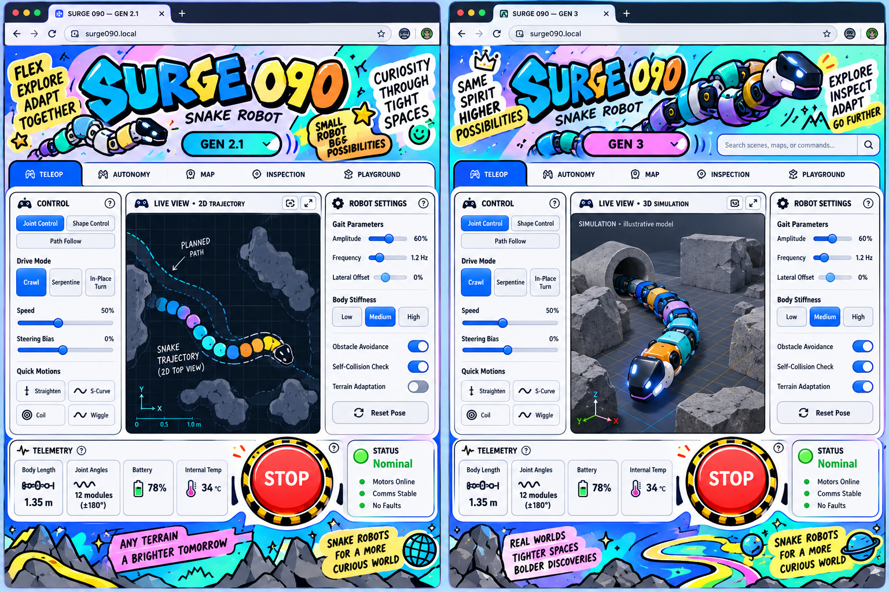

# SURGE 090 — Unified Playful Dashboard Implementation Plan

## Goal

Give the Gen 2.1 and Gen 3 dashboards a consistent, colorful, playful experience built around a shared central cockpit and task-tab navigation. Preserve the personality of the existing Slush-inspired design and the working tools of each generation.

## Visual direction

Use the concept as the visual reference for the shared structure, bold SURGE 090 heading, vivid blue, mint, lavender, orange and yellow palette, black outlines, rounded cards, stickers, expressive interactions, and prominent Stop control. Use the real dashboard's labels, controls, telemetry, and robot visuals in the implementation.

## Shared experience

- Place task tabs above the central cockpit. Use consistent tab shapes, selected states, keyboard navigation, and gliding hover feedback.
- Place the generation switch in the hero on both pages and retain its view transitions and information cards.
- Use the Gen 3 animated SURGE 090 heading treatment on both pages.
- Use consistent card, button, form, status, loading, error, and focus treatments while keeping clear variants for primary, secondary, warning, and Stop actions.
- Keep a consistently positioned, visible Stop control on both pages, with the existing generation-specific action and status feedback.
- Apply the Gen 2.1 telemetry-card hover vibration to shared telemetry cards, with reduced-motion support.
- Retain the animated background, hero snake, glass, shader, marquee, and other existing effects. Coordinate their timing and layering with the controls.
- Keep search on Gen 3, with results that navigate to controls without executing them.
- Present simulated, measured, stale, offline, and unavailable values clearly.

## Generation-specific workspaces

**Gen 2.1:** retain planar locomotion, the trajectory canvas, path drawing and waveform generation, live tracking, gamepad feedback, simulation physics controls, and joint telemetry.

**Gen 3:** retain the existing simulation view and its explanatory labels, gait tuning, finite trials, calibration map, single-joint jogging, diagnostics, runs, presets, firmware information, and operator-gated controls.

## Implementation phases

### 1. Current-state audit

1. Inspect both pages, task panels, controls, effects, and responsive layouts.
2. Recheck the existing dashboard audit against current behavior and record confirmed issues.
3. Review console errors, keyboard interactions, focus, labels, contrast, reduced motion, and animation performance.

### 2. Shared component system

1. Unify visual tokens, typography, card treatments, button variants, form states, telemetry cards, and status indicators.
2. Align navigation, hover, click, focus, loading, and error feedback across both generations.
3. Reuse existing effects and components, keeping behavior appropriate to each control.

### 3. Unified cockpit layout

1. Arrange each generation around the same header, hero, task navigation, central workspace, supporting controls, telemetry, and Stop placement.
2. Fit the cockpit to desktop, tablet, and mobile widths, keeping wide data tables in accessible scroll regions.
3. Keep each generation's tools and information clearly identified within the shared layout.

### 4. Interaction and visual polish

1. Apply the shared heading, generation transitions, telemetry vibration, tab indicator, and button feedback.
2. Refine animation timing, stacking, touch behavior, focus visibility, and reduced-motion alternatives.
3. Check that effects support readable information and responsive controls.

### 5. Functional and safety integration

1. Preserve existing control bindings, operator authentication, lease behavior, interlocks, and Stop handling.
2. Preserve the current joint map, calibration, servo settings, hardware limits, firmware, control algorithms, and backend interfaces.
3. Keep generation-specific commands and simulation data connected to their existing workflows.

### 6. Verification

1. Run the relevant frontend and backend regression suites.
2. Check both pages and all task panels at desktop and mobile sizes, including keyboard navigation, focus order, contrast, reduced motion, and table access.
3. Exercise navigation, search, status displays, error states, and simulation presentation with the robot disconnected.
4. Inspect browser errors and verify that telemetry and connection states reflect available data.

## Completion criteria

- Both generations share a recognizable cockpit layout, navigation pattern, component language, and playful visual identity.
- The requested heading, telemetry hover, and generation-switch effects are present and responsive.
- Generation-specific workflows remain available and clearly labeled.
- The relevant tests pass and the reviewed pages work across desktop and mobile widths.
