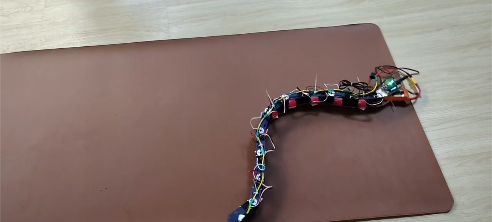

# SURGE-090 presentation update — v3 plan

Prepared 18 October 2026.

Source: `gen1-dynamixel/docs/presentations/Smart_Snake_Robot_SURGE090_Progress_Review_v2.pptx`.
Proposed output: `Smart_Snake_Robot_SURGE090_Progress_Review_v3.pptx`.
This document is the plan; the PowerPoint has not been edited.

## Scope and story

Keep slides **1–16 exactly as they are**, including their objects, images, notes,
order and numbering. Replace slides **17–29** with the current update, keeping
29 slides overall. Work on a copy and retain v2. No additional cover is needed.
Slide 29 remains the roadmap, preserving the reference on slide 16.

Slides 1–16 describe the earlier review. Their percentages, procurement status
and roadmap are historical. Introduce slide 17 verbally with:

> “That was the earlier stage of the project. Gen 2.0 and Gen 2.1 are now working,
> and our current development is the alternating-joint Gen 3 robot.”

Do not revise those older slides to imply they describe the present. The new
section follows this sequence: working robot → design decisions → mechanics and
power → two control arrangements → gait and tools → evidence → Gen 3 → next work.

Gen 1 remains the original ten-motor Dynamixel design. There is no need to reopen
its procurement details in this continuation. Use a team voice: “we designed”,
“we implemented”, “we are testing”. Avoid repository-audit language and generic
claims such as “fully validated”, “complete autonomy” or “100% complete”.

## Visual direction

The existing deck is 16:9 (13.333 × 7.5 inches), uses Calibri, and has a light
background with navy `#16223A` and teal `#0E96AC`. Keep those anchors so the new
section feels like a continuation.

Use light glassmorphism: a pale cool background, restrained teal/cyan glow,
and one translucent white surface behind text where it overlaps a photo.
Specify white fill at 15–25% transparency (75–85% opacity), a thin white border,
soft shadow and modest rounded corners. A second glass area is acceptable only
when comparing two things. Avoid a dashboard of small cards.

Glass is a presentation effect, not an interactive interface. PowerPoint does
not provide browser-style backdrop blur on arbitrary shapes; use a prepared
soft-focus decorative background beneath editable text if blur is needed.
Keep the evidence photograph itself sharp, particularly wires, joints and scales.

Use 32–36 pt titles, 20–24 pt body text and at least 16–18 pt captions where the
existing layout permits. Use navy for text; reserve teal for the main idea and
amber for unfinished work. Prefer a large photograph or diagram plus two or
three short statements. Keep margins close to the existing 0.58-inch grid.

## Motion language

Use Fade for routine changes (0.3–0.5 s), and Morph only where object continuity
helps explain the mechanism (0.6–0.9 s). Reveal labels on click and let related
parts follow after the previous animation. Avoid bounce, spin and looping text.

For the gait, use an explicitly labelled schematic: show a wave travelling along
ten joints, or highlight joints in phase order. This is an illustration of the
controller, not recorded robot motion. On signal-flow diagrams, animate a small
marker along the connection. Keep the completed diagram visible after the build.

Reserve one 16:9 frame for an actual 8–12 second locomotion video. Until footage
is supplied, place a real still photo there and label it “Video to be added”.
Do not slide a still robot photo across the page to imply measured locomotion.

If Morph is unavailable, use Fade with successive states. All slides must remain
understandable in a static PDF. Confirm animation playback in the presentation
software used for the review; effects are not implemented by this plan.

## Slide-by-slide continuation

### 17 — The planar robot is working; Gen 3 is next

**Main point:** establish the present before revisiting engineering decisions.

On-slide text:
- Gen 2.0: working planar robot and onboard/bench control.
- Gen 2.1: shared host control, dashboard and gamepad.
- Gen 3.0: alternating yaw/pitch design in development.

Visual: a large current prototype photo on the right, three short status lines
on the left. Use one glass text surface, not three status cards.
Photo: `gen2-st3215/media/20260925_164442.jpg`.
Motion: photo Fade, followed by the three status lines. No animated completion meter.
Speaker note: “The next slides explain what changed and how the working setup is organised.”

### 18 — The actuator changed; the modular idea stayed

**Main point:** explain the ST3215 decision without repeating slide 16.

On-slide text: ten-joint architecture retained; mounts and power redesigned;
servo communication moved to the ST3215 bus.

Visual: a compact Gen 1 → Gen 2 comparison, with only actuator, interface and
power architecture. Use `gen2-st3215/media/waveshare servo photo.png` alongside it.
Do not repeat numerical torque or cost ratios without voltage-specific datasheets
and dated purchase records. In particular, the old slide's 0.35 A figure must
not be reused as a Dynamixel stall-current specification.
Motion: reveal the ST3215 column after the original design column.
Speaker note: “The change affected mechanics, wiring and software together.”

### 19 — Eleven segments, ten coordinated joints

**Main point:** show the physical assembly rather than another CAD-only status slide.

On-slide text: modular body; ten yaw joints; daisy-chained servo connections.
Visual: `gen2-st3215/media/20260923_224427.jpg`, rotated for a landscape layout
only if it improves readability. Preserve the whole chain. Add a few clear
callouts to actual visible joints, wiring and body sections.
Motion: numbered joint callouts appear along the chain. These indicate joint order,
not measured timing. Confirm the visible actuator count before labelling the photo.
Speaker note: explain assembly and cable routing using the real photograph.

### 20 — Ground contact is part of the mechanism

**Main point:** explain why the body design affects forward motion.

On-slide text: yokes support the joint load; retention holds the motor;
longitudinal belly features are intended to resist lateral slip.
Visual: reserved close-up of a joint and belly, plus a v6 CAD view.
Placeholder: “Joint / belly close-up — add physical photo”. A whole-robot photo
is not enough to establish the small friction features. Keep the CAD labelled
“v6 design”; do not imply the photographed robot necessarily uses that revision.
Motion: reveal the load path, then the forward/lateral direction arrows.
Speaker note: treat directional friction as the design principle; quantitative
traction and clearance results need measurements. Do not repeat an unverified
±80° physical swing claim; current software limits are approximately ±70°.

### 21 — Power reaches the servos in five pairs

**Main point:** communicate the current split-bus design clearly.

On-slide text: 3S LiPo; main fuse and disconnect; five fused servo pairs;
separate buck supply for the controller.
Visual: simplify the existing `docs/hardware/wiring_split_bus_v3.svg` into an
editable presentation diagram. Preserve its distinction between power and DATA/GND.
Use one colour for servo power, another for data. Label it “Power design v3”.
Motion: reveal battery → protection → servo groups, then the controller branch.
Speaker note: explain why power is distributed. Avoid old “missing” labels,
claimed runtime or confirmed fuse ratings on the actual build without current
hardware inspection. Reserve a small “Installed wiring photo” space if available.

### 22 — Gen 2.0 keeps the gait on the robot

**Main point:** explain the onboard arrangement independently of host control.

On-slide text: `robot_esp32_v2` computes the gait; current feedback feeds the
stall-response state machine; ESP-NOW carries telemetry to the base station.
Visual: Robot ESP32 → servo chain, with a separate telemetry route to base ESP32
and Raspberry Pi. Add a small reverse → turn → resume sequence.
Motion: a marker follows the telemetry route once; reveal the response sequence
on a separate click. No promise that the robot identifies obstacle side.
Speaker note: current thresholds and evasion reliability remain calibration topics.
The Gen 2.0 raw-bus bench mode can be mentioned briefly, not drawn as another full diagram.

### 23 — Gen 2.1 moves target generation to the host

**Main point:** make the second control arrangement unmistakable.

On-slide text: shared gait controller; USB or ESP-NOW relay; receiver applies
targets and returns feedback. Start, stop and target timeout manage motion state.
Visual: PC/Pi app → USB or transmitter → receiver → servo bus. Place the separate
sensor node on its own input path. Do not merge this with slide 22's architecture.
Motion: reveal command direction first, then feedback direction.
Speaker note: Gen 2.1 has a 750 ms command watchdog; it does not inherit the
Gen 2.0 battery/temperature cutoffs or evasion state machine.

### 24 — A travelling wave coordinates the joints

**Main point:** explain the gait visually.

On-slide equation: θᵢ(t) = A sin(ωt − iφ) + b.
Define A = amplitude, ω = temporal frequency, φ = phase lag, b = steering bias.
Visual: an editable ten-joint schematic in three successive phases. Use a small
still from `gen2-st3215/media/20260925_164828.jpg` to relate the schematic to the
physical body. Do not reuse this photo elsewhere in the continuation.
Motion: Morph between schematic states, or reveal the three phases sequentially.
Caption: “Controller illustration; not a measured trajectory”.
Speaker note: Gen 2.0 and Gen 2.1 have different defaults. Avoid presenting
400 ticks, 0.8 rad, 1.2 rad and 1.0 rad as one parameter set. Use the equation
without fixed values unless showing a specific recorded configuration.

### 25 — One controller, several ways to work with it

**Main point:** show the practical benefit of the shared software.

On-slide text: dashboard for tuning and feedback; desktop/headless modes for
simulation; gamepad for manual steering.
Visual: reserve one large current dashboard screenshot. Add a narrow secondary
space for the PyBullet view if both are legible; otherwise use only the dashboard.
Placeholders: “Gen 2.1 dashboard screenshot” and “11-link PyBullet view”.
Motion: screenshot Fade, then highlight the selected engine, start/stop and feedback.
Speaker note: paths and accuracy reports are simulation-only. The robot does not
have the localization required for physical path tracking. Do not reuse an old
screenshot showing a different joint count without identifying it as historical.

### 26 — What we can demonstrate now

**Main point:** distinguish demonstrated operation from measurements still to collect.

On-slide text: working Gen 2 operation; command and feedback interfaces;
software simulation. Separate line: speed, slip, power consumption and stop latency
still need a consistent measurement record.
Visual: a large 16:9 demonstration frame. Until video is supplied, use
`gen2-st3215/media/Screenshot_20261016_012632_WhatsApp.jpg` with “Video to be added”.
A small table can list “Physical operation / software checks / measurements”
without inventing scores, charts or completion percentages.
Motion: actual video starts on click when added. Otherwise use a static image.
Speaker note: describe what was observed, the surface and the controller used.
Do not claim the Gen 2.1 sensor stream proves autonomous navigation.

### 27 — Gen 3 introduces alternating yaw and pitch

**Main point:** show the current research direction.

On-slide text: alternating joint axes; revised connectors and plate-chain layout;
experimental 3D waveform.
Visual: reserve a CAD screenshot from `gen3-experimental-3d/cad/`, with yaw and
pitch axes labelled. Use a second state of the same model for a deliberate
motion illustration, not an unrelated stock robot.
Placeholder: “Gen 3 CAD — connector and joint-axis view”.
Motion: highlight yaw and pitch alternately; use a restrained rotation or Morph
of the schematic only. Label the state “Design / experiment”.
Speaker note: the script defaults to dry run; CAD candidates and the waveform
are not yet proof of a completed 3D locomotion system.

### 28 — The next experiments answer specific questions

**Main point:** turn future work into testable questions.

On-slide text:
- How does surface contact affect forward travel and slip?
- How repeatable are steering and stop response?
- What changes when pitch joints carry the body out of the plane?

Visual: an uncluttered three-row experiment table: question → observation to record.
Keep quantities blank until measured: distance/time, lateral drift, voltage/current,
stop delay, joint clearance and body contact. Use fewer measures on the slide;
put the complete list in speaker notes.
Motion: reveal one row per click. This should be quieter than the mechanism slides.
Speaker note: select the controller and test surface for each record so later
results are comparable. Do not invent deadlines, success rates or budget totals.

### 29 — From the working planar robot to Gen 3 trials

**Main point:** end on a concrete roadmap and retain slide 16's cross-reference.

On-slide progression: working Gen 2 reference → repeatable measurements →
Gen 3 assembly and joint checks → coordinated 3D motion trials.
Closing sentence: “The planar platform gives us a working base for the next set
of mechanical and gait experiments.”

Visual: a simple four-stage timeline; distinguish the working reference from the
three next stages. Use a small repository URL and team names, not another full cover.
Motion: reveal the existing base first, then the next stages. End with the complete
roadmap visible for discussion. Avoid an invented percentage or calendar.
Speaker note: invite questions on mechanics, control or the Gen 3 experiment.

## Photo board and asset assignments

These are original project images. Each is assigned a purpose rather than used
as decoration. The previews below link to the existing files; no photo was edited
or generated for this plan.

### Slide 17 — current robot

### Slide 18 — actuator

### Slide 19 — full chain

### Slide 24 — physical counterpart to the wave illustration

### Slide 26 — temporary demonstration still

### Spaces to leave open

| Slide | Space | Needed material |
|---|---|---|
| 20 | Two side-by-side close views | Physical joint/belly photo and matching v6 CAD screenshot |
| 21 | Small landscape inset, optional | Installed power wiring with visible connections |
| 25 | Large landscape screenshot | Current dashboard in a clearly identified SIM or hardware state |
| 25 | Secondary view, optional | Current PyBullet model |
| 26 | 16:9 video frame | Short real locomotion clip; use the assigned still until available |
| 27 | Large CAD view | Gen 3 connector and alternating axes; identify the actual revision |

Placeholders should have the intended aspect ratio, a thin teal outline and a
short neutral label. They should look like deliberate reserved space. Do not
fill them with generic robot imagery or generated evidence.

## What changes from the existing slides 17–29

- Old actuator slide: replace dense numeric comparison with a short design decision.
- Old architecture/firmware slides: distinguish Gen 2.0 onboard from Gen 2.1 host control.
- Old bus-register table: move to speaker notes or optional appendix material;
  it interrupts the main progress story.
- Old three-slide CAD section: condense into the assembly and ground-contact story;
  keep detailed calculations as reference, not automatically verified results.
- Old power and missing-parts slides: use current v3 design and verify installed
  hardware before making present-tense inventory claims.
- Old gait slide: use consistent symbols and a motion illustration; do not mix
  frequency units or parameter defaults from different controllers.
- Old “proven without hardware” slide: replace with actual operation and a clear
  distinction between observations, software checks and future measurements.
- Old budget/procurement slide: remove stale totals from the main update. Retain
  only if a current dated bill of materials is supplied for an optional appendix.
- Old roadmap: replace with the working Gen 2 → measured trials → Gen 3 sequence.

## Build and review checklist for the eventual PowerPoint

1. Save a v3 copy. Record slide 1–16 content and appearance before editing.
2. Replace 17–29 in the copy. Keep the 16:9 canvas and existing fonts/colour anchors.
3. Add exact photo assignments and labelled spaces for missing evidence.
4. Add speaker notes with hardware/software distinctions and the source file for
   each technical claim. Keep figures out unless the source supports them.
5. Apply glass styling to the new slides only. Do not change a shared master in
   a way that changes slides 1–16.
6. Add click-driven motion after static layouts are readable. Keep the sequence
   short enough to present comfortably; rehearse the update in roughly 10–12 minutes.
7. Render all slides for review, checking text, crops, equations, captions and contrast.
8. Compare slides 1–16 against v2 and play the new section in PowerPoint. Confirm
   slideshow animations separately from PDF appearance.
9. Deliver the editable v3 PowerPoint and a static PDF; retain the v2 source.

The current plan changes no PowerPoint, image, CAD or software files. Missing
photos and videos can be added later without changing the slide sequence.
