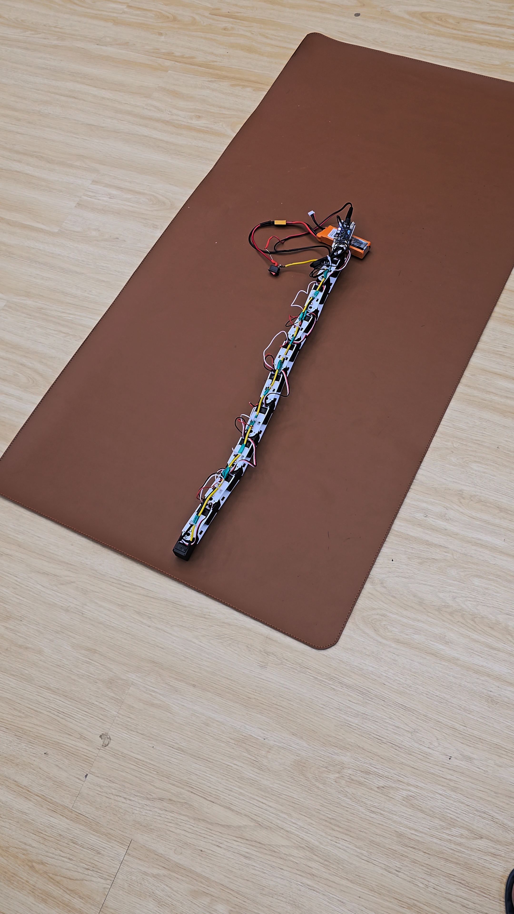

# Gen 2 prototype photos

These photos show the assembled ST3215 snake robot in straight and curved
configurations during our Gen 2 work. Gen 2.0 and Gen 2.1 are working; the
alternating-joint Gen 3 design is still in development.

## Assembly

## Planar robot

[Another view](20260925_164828%281%29.jpg) ·
[Additional assembly view](20260925_164828%282%29.jpg)

## Additional views

[Side view](Screenshot_20261016_012617_WhatsApp.jpg) ·
[Assembly screenshot](Screenshot_20261016_012618_WhatsApp.jpg) ·
[Curved configuration](Screenshot_20261016_012632_WhatsApp.jpg) ·
[Full-chain view](Screenshot_20261016_012633_WhatsApp.jpg)

The photos were cropped for the repository on 16 October 2026. Videos have not
been added yet. Large media kept in `local-only/` is excluded from Git.

[Gen 2 design and control](../README.md) · [Project history](../../README.md)
