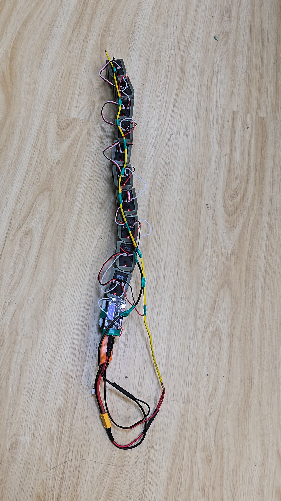
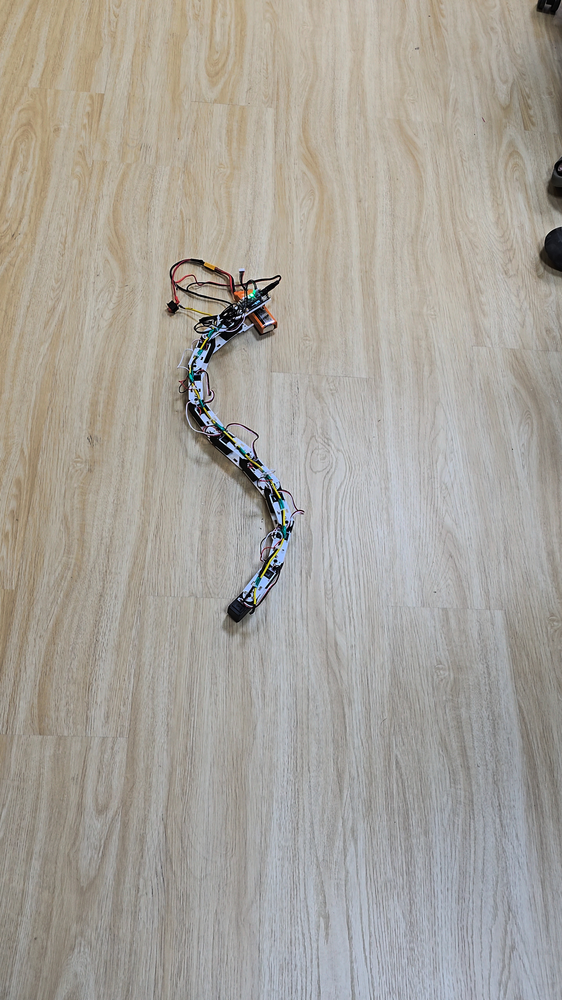

# Gen 2 working prototype — photo gallery

Gen 2.0 and Gen 2.1 are working in project trials, confirmed by the project
maintainer on 16 October 2026. These photographs show the assembled robot and
trial configurations; still images do not establish gait speed or stop latency.

All nine new JPEGs are included at original quality. No videos have been added.

| Photo | Size (MiB) |
|---|---|
| [20260923_224427.jpg](20260923_224427.jpg) | 2.26 |
| [20260925_164442.jpg](20260925_164442.jpg) | 2.39 |
| [20260925_164828(1).jpg](20260925_164828%281%29.jpg) | 1.62 |
| [20260925_164828(2).jpg](20260925_164828%282%29.jpg) | 1.68 |
| [20260925_164828.jpg](20260925_164828.jpg) | 1.81 |
| [Screenshot_20261016_012617_WhatsApp.jpg](Screenshot_20261016_012617_WhatsApp.jpg) | 0.12 |
| [Screenshot_20261016_012618_WhatsApp.jpg](Screenshot_20261016_012618_WhatsApp.jpg) | 0.43 |
| [Screenshot_20261016_012632_WhatsApp.jpg](Screenshot_20261016_012632_WhatsApp.jpg) | 0.08 |
| [Screenshot_20261016_012633_WhatsApp.jpg](Screenshot_20261016_012633_WhatsApp.jpg) | 0.48 |

## Preview

## Future videos

Place large video originals in `local-only/` to keep them on this computer
without adding them to Git. Review size and content before publishing selected
clips or release assets. GitHub warns above 50 MiB and blocks regular Git files
above 100 MiB; see [GitHub file guidance](https://docs.github.com/en/repositories/working-with-files/managing-large-files/about-large-files-on-github).
